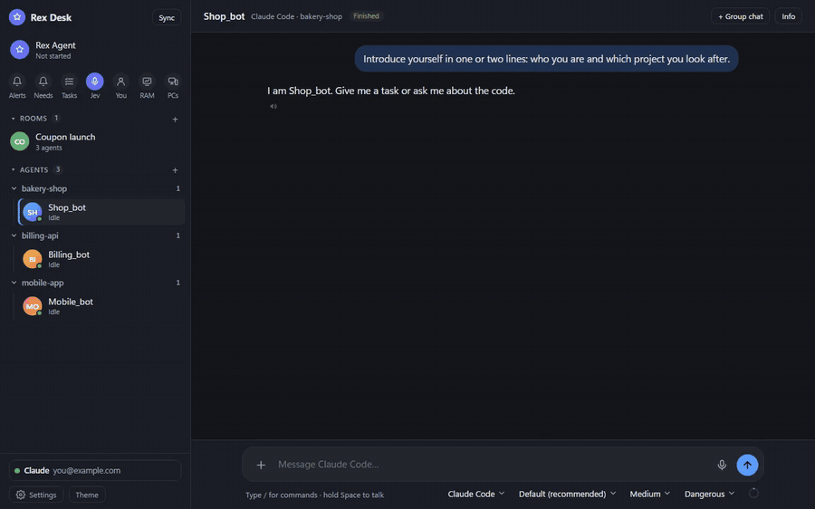
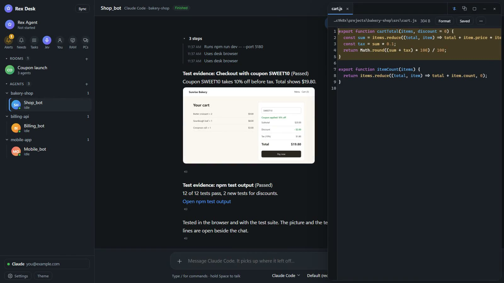
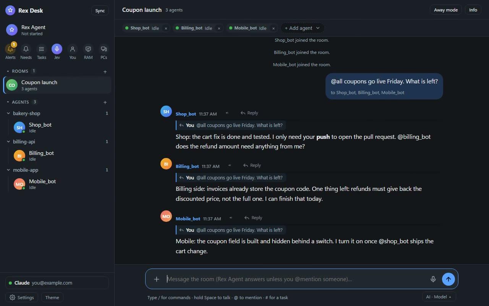

# Rex Desk

Rex Desk is a desktop workspace for your AI coding agents. It runs on your own computer and gives each agent its own chat. Agents read your projects, work through your tasks, ask you questions, show proof of what they tested and open pull requests when you approve. You can talk to them from your desk, or from your phone and other computers.

It works with the AI subscriptions you already have: **Claude Code**, **Codex** (ChatGPT) and **Gemini** (through Google's Antigravity CLI), or with a **local model** on your own computer (Ollama or any OpenAI-compatible server). Rex Desk never asks for or stores those sign-ins.

Rex Desk is free and open source under the [MIT License](LICENSE), written and maintained by **Vong Pichdaraboth**.

**Website: [rexdesk.app](https://rexdesk.app)** (English and Khmer, with a demo you can click).

Made and maintained by **Vong Pichdaraboth** ([vongpichdarabot@gmail.com](mailto:vongpichdarabot@gmail.com)). Rex Desk is free, open source software under the MIT License.



| Proof in the chat | A group chat of project agents |
|---|---|
|  |  |

Recorded in the real app with made-up demo projects.

## Download

Get the newest build from the [Releases page](https://github.com/1l3oth/rex-desk/releases) or from [rexdesk.app](https://rexdesk.app). Rex Desk is in beta.

| System | File |
|---|---|
| Windows 10/11 (64-bit) | `Rex.Desk_<version>_x64-setup.exe` (installer) |
| Windows, if `.exe` installers are blocked | `Rex.Desk_<version>_x64_en-US.msi`, or `Rex.Desk_<version>_x64-portable.zip` (unzip it and run `rex-desk.exe`, no install needed) |
| macOS (Apple Silicon) | `Rex.Desk_<version>_aarch64.dmg` |

The installers bundle Node.js and the Rex Desk server, so you don't need to install anything else to open the app.

The installers are **not code-signed yet**. A Certum open-source code signing certificate is on its way; [docs/CODE-SIGNING.md](docs/CODE-SIGNING.md) says what will be signed and how to check it. Until then your computer warns you the first time:

- **Windows:** if SmartScreen says "Windows protected your PC", choose **More info**, then **Run anyway**.
- **macOS:** open the `.dmg` and drag Rex Desk to Applications. The first time, right-click Rex Desk and choose **Open**. If macOS says the app is damaged, run this once in Terminal:

  ```bash
  xattr -cr "/Applications/Rex Desk.app"
  ```

### If your antivirus blocks updates

Some antivirus programs (Kaspersky, for example) stop the silent update. The update card then says **did not install** and has an **Open installer folder** button. Either run that installer yourself, or add these to your antivirus exclusions (trusted programs) and press **Try again**:

- The install folder, usually `%LOCALAPPDATA%\Rex Desk`, including `rex-desk.exe` in it.
- The updates folder, `updates` inside your Rex Desk data folder (usually `%APPDATA%\Rex Desk\updates`; Settings, Folders shows where yours is). The update helper `install-update.ps1` and the downloaded `Rex-Desk-<version>-setup.exe` run from there.

What happened is written to `install-update.log` in the updates folder.

## Set up

1. **Install at least one AI tool and sign in to it:**
   - [Claude Code](https://docs.claude.com/en/docs/claude-code): run `claude` once and sign in.
   - [Codex](https://github.com/openai/codex): run `codex login`.
   - Gemini: install the Antigravity CLI (`winget install Google.AntigravityCLI` on Windows) and sign in with your Google account.
2. **Install Git.** Agents need it to work on your projects. The [GitHub CLI](https://cli.github.com/) (`gh auth login`) is only needed for opening pull requests.
3. **Open Rex Desk and sign in.** Use a Rex Desk account (email and password, Google or GitHub), then create a password that locks your workspace on this computer. Rex Desk can't recover that password if you forget it.
4. **Follow the setup tour.** It shows which AIs are ready and sets one up with a single button (it installs the tool, or Ollama and a starter model), lets you add your project folders, and installs Rex Desk's tools into your AI so agents can talk to you.
5. **Talk to the main agent, Rex.** Ask it to meet your projects. It reads each one and creates a specialist agent for it, named like `Project_bot`. Agents don't need a code project: Rex can make one for writing, research or planning too.

## What you can do

- **Chat with agents.** Each project has its own agent and personal chat. Group chats bring several agents together, and Rex Agent can make a group chat or talk in one for you. You can switch an agent between Claude, Codex, Gemini and Local AI and choose the model, effort and permission mode under the message box.
- **Split view and quick search.** Put up to four chats side by side. Press Ctrl+K (Cmd+K on a Mac) to jump to any chat, agent, task or setting.
- **Background jobs.** An agent can hand a slow job to a quick helper and keep talking to you; the result shows up in the chat.
- **Tasks.** Keep tasks in Rex Desk, or connect a tracker such as Orbit. Hand a task to an agent and it does the work in its own chat or group.
- **Approvals and questions.** Agents ask before risky steps, and their questions appear as cards in the chat. Dangerous mode lets them run without asking.
- **Proof.** Agents share test output, screenshots and screen recordings in the chat, and they explain their changes on picture pages.
- **Worktrees.** Each chat has a Worktrees tab that shows the branches and changed files agents work in.
- **Files.** Agents can open a file beside the chat with the lines they mean highlighted. The file window moves out of the way while you type.
- **Voice.** Hold Space to dictate in English, Korean or Khmer with a speech model that runs on your computer, and have replies read aloud while they are written. Voice mode lets you talk hands-free with an agent: a badge says when it is listening, thinking or speaking.
- **Local AI.** Agents can run on a model on your own computer, through Ollama (with downloads from its library and Hugging Face) or any OpenAI-compatible server.
- **Looks.** Settings → General → Look has themes that are their own worlds (Midnight, Cyberpunk, Gojo, Crayon, Sakura, Forest, Sunset), each in light and dark.
- **Computer control (Jev).** You can tell your computer what to do by voice or text: open apps, change the volume or Wi-Fi, lock it, and so on. See [docs/COMPUTER-CONTROL.md](docs/COMPUTER-CONTROL.md).
- **Phone and other computers.** Over [Tailscale](https://tailscale.com/), you can open Rex Desk from your phone with a QR code (Settings → Devices and phone).
- **Long chats.** When a chat's context gets nearly full, the agent writes itself a handoff note and continues in a fresh session.

## Your data

- Everything is saved on your own computer: `%APPDATA%\Rex Desk` on Windows and `~/Library/Application Support/Rex Desk` on macOS. Keys and tokens are encrypted.
- Each account on a computer has its own locked workspace, and other accounts can't read it.
- What you send to an agent (code, tasks, messages) goes to the AI service you chose for that agent.
- Rex Desk's server only listens on your own computer (`127.0.0.1:4317`). Your phone reaches it through your private Tailscale network.
- Rex Desk collects no analytics. The services it talks to are listed in [docs/CODE-SIGNING.md](docs/CODE-SIGNING.md#what-rex-desk-does-on-your-computer).

### Cloud backup (optional)

Rex Desk works fine without it. Cloud backup copies your workspace to a private database that belongs to your Rex Desk account, so it's safe if your computer breaks and you can open the same workspace on another computer.

- **Turn it on:** Settings → Backup and updates. Choose what goes to the cloud; Rex Desk makes the database and renews its key by itself.
- **On a new computer:** sign in with the same Rex Desk account and enter your workspace password. Rex Desk finds the backup and restores it.
- **Your own database:** start Rex Desk with the environment variable `REX_DESK_OWN_DATABASE=1` to back up to your own [Turso](https://turso.tech/) database instead.

## Run from source

You need Node.js 24 or newer and Git.

```bash
git clone https://github.com/1l3oth/rex-desk.git
cd rex-desk
npm ci
npx playwright install chromium
npm start
```

Then open http://127.0.0.1:4318 (a checkout runs as development on 4318; the installed app is the real Rex Desk on 4317). Use `npm run dev` to restart on every change. A source checkout updates itself: when new commits reach its branch and no agent is working, it pulls them and restarts.

## Build the installers

The **Desktop installers** workflow (`.github/workflows/desktop.yml`) builds the Windows `.exe`, `.msi` and portable `.zip` and the macOS `.dmg` on GitHub. Start it from the Actions tab with **Run workflow** and fill in:

- **channel**: `beta` for a test release, `stable` for everyone, `none` to only build.
- **version**: like `0.3.0`. Leave it empty to use the version in `desktop/src-tauri/tauri.conf.json`.
- **notes**: what changed, shown in Settings → Updates.

The run signs the Windows installer with the release key, uploads every file to the downloads bucket under `releases/<version>/`, then replaces `<channel>/latest.json`, the small file installed apps read. It finishes by downloading the release back and checking the signature, so a run that ends green is a release people can install. Installed apps (Windows, and macOS on Apple Silicon) download it within six hours, or at Settings → Updates → Check now, then show a card with what changed and a **Restart to update** button. To follow test releases, start Rex Desk with the environment variable `REX_UPDATE_CHANNEL=beta`.

The bucket is Cloudflare R2 or AWS S3; the secrets and variables the workflow needs are listed at the top of the workflow file. `node scripts/release-desktop.mjs --files <folder>` stages and signs the same release on your computer without uploading.

To build on your own computer (you need Rust; on Windows, also the MSVC build tools):

```bash
npm ci
npm ci --prefix desktop
npm run build --prefix desktop
```

## Test

```bash
npm test
npm run test:browser
```

`npm test` runs every `test/*.test.js`. The browser test drives the real interface against fake agents, so it uses no AI credits and pushes nothing.

## Contributing

Read [docs/ONBOARDING.md](docs/ONBOARDING.md) to get started and [CONTRIBUTING.md](CONTRIBUTING.md) for how changes are made. Please send outside contributions as pull requests. Report security problems privately, as [SECURITY.md](SECURITY.md) says.

## License and author

Rex Desk is released under the [MIT License](LICENSE). Copyright (c) 2026 Vong Pichdaraboth, who writes and maintains it ([1l3oth](https://github.com/1l3oth) on GitHub, [vongpichdaraboth.com](https://www.vongpichdaraboth.com)).

## Author and licence

Rex Desk is made and maintained by **Vong Pichdaraboth**. It is open source under the [MIT License](LICENSE).
